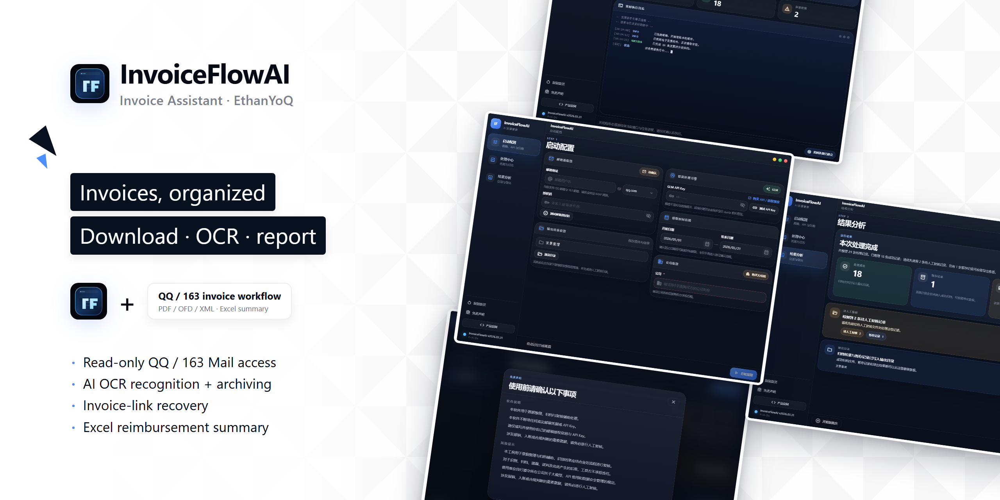
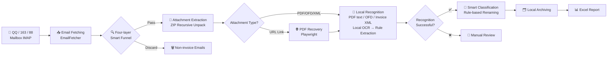
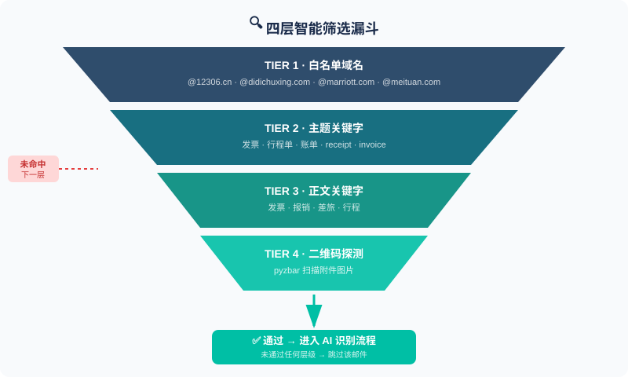
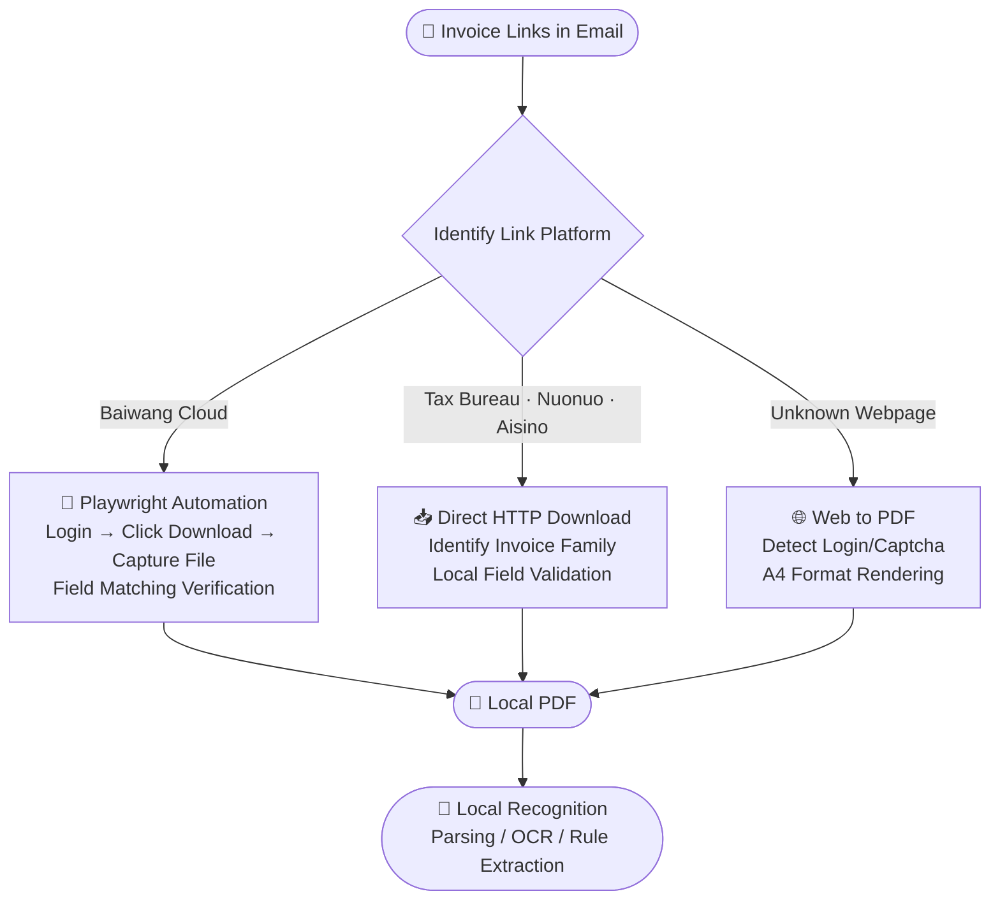

# InvoiceFlowAI — E-Invoice Organization and Reimbursement Preparation

<div align="center">

**English** | [中文](README.md)

</div>


<div align="center">


**Turn PDF, OFD, and XML e-invoices from your mailbox, plus supported invoice download links, into organized files and an Excel reimbursement summary.**

Designed for individuals, freelancers, and small teams that manually collect multiple e-invoices each month. Connect your own QQ Mail, 163 Mail, or 88 Mail account to collect invoices in batches, parse and OCR them locally, archive them by category, and create a summary while retaining unclear results for human review.

Download: [latest Windows installer / portable package and macOS (Apple Silicon) installer](https://github.com/EthanYoQ/Invoice-Downloader/releases/latest)

*Email and invoice files are processed locally from start to finish: e-invoices are parsed directly, while scans and images go through the bundled local OCR. Recognition needs no network and no API key, and invoice content is never uploaded.*

</div>

<p align="center">
  
</p>

## DeepSeek Harness Plugin

`@ethanyoq/dsh-invoice-downloader` brings local IMAP invoice download, local parsing and OCR, archiving, and Excel summaries to a right-side DeepSeek Harness panel. It is intended for reimbursement workflows that automate repetitive organizing while keeping a human review step.

```sh
dsh plugin --profile web add @ethanyoq/dsh-invoice-downloader
dsh web --profile web
```

Open **Invoice Downloader** from the right-side entry, choose an output directory, install the local engine once, and enter a QQ Mail, 163 Mail, or 88 Mail IMAP authorization code. First-time setup needs network access to download Python dependencies and Chromium; the `rapidocr-onnxruntime` pip wheel includes the default PP-OCRv3 models, so no separate manual model download is required. Invoice files and recognized text are processed entirely on this machine; the plugin needs no model or API key. The plugin supports Windows x64 and macOS Apple Silicon. The DSH credential service stores authorization codes, never plugin settings or scan logs.

---

## ✨ Key Highlights

| &nbsp; | Feature | Description |
|--------|---------|-------------|
| 🔒 | **One-click launch, ready to use** | Extract and run — no need to install Python or any dependencies |
| 🔎 | **Local recognition engine** | PDF text layers, OFD, and digital-invoice XML are parsed directly; scans and images go through bundled local OCR — no network or API key needed |
| 🔍 | **Four-layer smart funnel** | Whitelist domains → Subject keywords → Body detection → QR code scanning, precisely filtering non-invoice emails |
| 📄 | **Link-based invoice auto-recovery** | Playwright automatically opens Baiwang Cloud and tax platform links, downloading official PDF archives |
| 🧾 | **Automatic invoice/document pairing** | Hotel invoice/folio and ride invoice/itinerary pairs are archived with adjacent names |
| 🪟 | **Quiet background processing** | URL workers, Node, and Chromium run without repeatedly opening console windows |
| 🗂️ | **Natural language classification rules** | Supports custom rules like "Didi rides over 100 yuan go into the high-amount category" |
| 📊 | **One-click Excel report** | Automatically generates `summary_report.xlsx`, covering invoice lists and amount summaries |

---

## 🏗️ Overall Workflow



---

## 🔎 Local Recognition Chain

Recognition runs entirely on this machine in the order "deterministic parsing first → local OCR fallback → rule extraction and checks". No network access, API key, or model service is involved.

> **Processing order**
> - **Text-layer PDF**: layout text is read directly with PyMuPDF, without OCR
> - **OFD / digital-invoice / VAT XML**: parsed directly by container structure and field aliases
> - **Scans and images**: handled by the bundled local OCR (RapidOCR + ONNX Runtime; models ship with the dependency)
> - **Rule extraction**: fields are mapped by anchor and regex rules, for example amounts are located via the "tax-inclusive total (in words) / (in figures)" anchors
>
> **Offline consistency checks**: verify that the amount plus tax reconciles with the tax-inclusive total, that dates are parseable, and that invoice numbers are valid digit strings; anything that cannot be confirmed is not guessed but routed to Manual Review for the user to check.

---

## 🔍 Four-Layer Smart Filtering Funnel

The system does not run recognition on every email. Instead, it first passes through a four-layer funnel for precise filtering, reducing wasted recognition and false positives.



After passing the filter, attachments also go through a **three-tier decision process**:

| Tier | Trigger Condition | Handling |
|------|-------------------|----------|
| 🗑️ **Tier A** (Discard) | Tracking pixels, logos, decorative images (≤32px) | Skipped directly |
| 📦 **Tier B** (Hold) | Attachments >5MB, ZIP unpack failure | Retained but not processed |
| ✅ **Tier C** (Archive) | Normal PDF/OFD/XML | Enters local recognition pipeline |

---

## 🌐 Three-Tier PDF Recovery Strategy

Many invoice emails only contain "click to download" links. The system automatically identifies the platform and selects the optimal approach:



---

## ⚙️ Configuration Guide

> Only needs to be configured once on first use (email address and authorization code); after that, just click run for each scan. The recognition engine is built in — no model or API key required.

### Step 1 · Enable 163 Mailbox IMAP

<details>
<summary>📖 Click to expand detailed steps for 163 mailbox</summary>

**Server Parameters**

| Parameter | Value |
|-----------|-------|
| IMAP Server | `imap.163.com` |
| Port | `993` (SSL/TLS) |

**Setup Steps**

1. Log in to [mail.163.com](https://mail.163.com), click **Settings** in the upper right corner
2. Select **POP3/SMTP/IMAP** from the dropdown menu
3. Find **IMAP/SMTP Service**, click the **Enable** button on the right
4. An "Account Security Verification" window will appear:
   - **QR Code Method** (Recommended): Scan the QR code with your phone to automatically send a verification SMS
   - **Manual Method**: Manually send an SMS to the designated number as prompted
5. After sending the SMS, click **I Have Sent It**
6. The system generates a **16-character authorization code** (letter combination, **only displayed once — copy and save it immediately**)

> ⚠️ The authorization code is not your mailbox login password. It is a separate password specifically for third-party clients, and it is case-sensitive.

📚 [163 Mailbox Official Help](https://help.mail.163.com/)

</details>

---

### Step 2 · Enable QQ Mailbox IMAP

<details>
<summary>📖 Click to expand detailed steps for QQ mailbox</summary>

**Server Parameters**

| Parameter | Value |
|-----------|-------|
| IMAP Server | `imap.qq.com` |
| Port | `993` (SSL/TLS) |

**Setup Steps**

1. Log in to [mail.qq.com](https://mail.qq.com), click the **Settings** icon in the upper right corner
2. Select the **Account** tab
3. Find **POP3/IMAP/SMTP/Exchange/CardDAV/CalDAV Service**
4. Click **Manage Service** → **Enable Service**
5. Click **Generate Authorization Code** and complete identity verification:
   - **QR Code Method** (Recommended): Scan the QR code with your phone to automatically send a verification SMS
   - **Manual Method**: Send "Configure Email Client" to **1069070069** using your QQ-linked phone
6. Click **I Have Sent It** — the authorization code is generated instantly after verification (**save it immediately**)

> ⚠️ The authorization code automatically becomes invalid after changing your QQ password and must be regenerated.

📚 [QQ Mailbox Official Help](https://service.mail.qq.com/detail/0/339)

</details>

---

### Step 3 · Enable 88 Mailbox IMAP

<details>
<summary>📖 Click to expand detailed steps for 88 mailbox</summary>

**Server Parameters**

| Parameter | Value |
|-----------|-------|
| IMAP Server | `imap.88.com` |
| Port | `993` (SSL/TLS) |
| Username | Full email address |
| Password | Dedicated password generated in the mailbox settings |

**Steps**

1. Log in to [mail.88.com](https://mail.88.com) and open **Settings** → **POP Settings**
2. Confirm that **IMAP/SMTP service** is enabled
3. In the **Dedicated Password** section, click **Add Dedicated Password**
4. Enter a name (for example, `InvoiceFlowAI`) and copy the generated random password immediately
5. In the app, enter the full email address and put the dedicated password in the authorization code field

> ⚠️ The dedicated password is not your mailbox login password. It is intended for third-party mail clients, so keep it separately.

</details>

---

## 🚀 Quick Start

### Windows (installer / portable)

1. Installer: run `InvoiceFlowAI-*-windows-x64-setup.exe`. Portable: extract `InvoiceFlowAI-*-windows-x64-portable.zip` to a regular folder (avoid cloud-sync directories) and keep `_internal` beside `InvoiceFlowAI.exe`.
2. Double-click `InvoiceFlowAI.exe`; the settings interface appears on first launch.
3. Enter your email address and authorization code (QQ, 163, or 88), then click "Start Scanning". Recognition runs offline on this machine — scans and images are handled by the bundled OCR, with no network or API key needed. Invoices are archived to the "Invoice Organizer" folder on your desktop.

### macOS (Apple Silicon)

1. Open `InvoiceFlowAI-*-macos-arm64.dmg` and drag `InvoiceFlowAI` to Applications.
2. The settings interface appears on first launch. This build is unsigned and not notarized; if macOS blocks it, confirm opening it in **System Settings → Privacy & Security**.
3. Enter your email address and authorization code (QQ, 163, or 88), then click "Start Scanning". Recognition runs offline on this machine — scans and images are handled by the bundled OCR, with no network or API key needed.

---

## 📁 Output Directory Structure

```
Invoice Organizer/
├── Train Tickets/
│   └── 20260315-Beijing-Shanghai-Train-Ticket.pdf
├── Flight Tickets/
│   └── 20260301_Flight_1280.00_Air-China.pdf
├── Hotel Invoices/
│   ├── 20260310-Hotel-01-Invoice_888.00.pdf
│   └── 20260310-Hotel-01-Folio_888.00.pdf
├── Taxi/
│   ├── 0312-DiDi-01-Invoice_45.50.pdf
│   └── 0312-DiDi-01-Itinerary_45.50.pdf
├── Dining/
├── Manual Review/     ← Materials that cannot be confirmed reliably
├── Non-target Company Invoices/
└── summary_report.xlsx
```

---

## ❓ FAQ

<details>
<summary>Q: White screen or no response after launching the software?</summary>

- Make sure the **entire archive is extracted**; the `_internal` folder must be in the same directory as `InvoiceFlowAI.exe`
- Avoid placing the software in a directory containing **Chinese characters or spaces**

</details>

<details>
<summary>Q: Very few invoices found after scanning?</summary>

- In the software's time range settings, **adjust the start date to more than 180 days ago**
- Some mailboxes default to fetching only the last 30 days of emails — select "Fetch all emails" in the mailbox IMAP settings

</details>

<details>
<summary>Q: Authentication failure after entering the authorization code?</summary>

- **QQ Mailbox**: Must be obtained through "Manage Service → Generate Authorization Code" — it is **not your QQ password**
- **163 Mailbox**: Must be generated from the "Enable IMAP Service" popup — it is **not your mailbox login password**, and it is case-sensitive
- **88 Mailbox**: Use the dedicated password generated under "Settings → POP Settings → Add Dedicated Password" — it is **not your mailbox login password**
- The QQ authorization code must be regenerated after changing your QQ password

</details>

<details>
<summary>Q: Does recognition need network access or an API key?</summary>

No. E-invoices are parsed directly on this machine, and scans or images go through the bundled local OCR whose models ship with the software. Recognition never goes online, never calls a model service, and requires no API key.

</details>

<details>
<summary>Q: Some invoices end up in the Manual Review folder?</summary>

This is normal. When local parsing and rule checks cannot confirm a result reliably, the system places the invoice in the Manual Review folder for human confirmation. This is usually caused by blurry images, non-standard documents, or encrypted PDFs.

</details>

---

## 🛡️ Privacy & Security

- All emails and invoice files are processed **locally** and are never uploaded to any server
- Mailbox credentials are encrypted with **DPAPI** on Windows and stored in **Keychain** on macOS
- Recognition runs entirely on this machine: e-invoices are parsed directly, scans and images go through the bundled OCR; no model service is called and no invoice content is sent

---

## ⚠️ Disclaimer

By using this software, you acknowledge and accept the following terms.

**Compliant Use** · This software accesses mailboxes through IMAP in **read-only** mode. It does not send, delete, or modify any emails. Users must ensure they have legitimate authorization for the mailboxes being processed.

**Purpose** · This software is intended only as an automation assistant for downloading, recognizing, classifying, and archiving invoice-related emails and files.

**Accuracy & Compliance** · The author does not warrant the accuracy, completeness, legality, tax compliance, financial compliance, or accounting compliance of any invoice data or generated results. Users must independently verify all invoices, reimbursements, tax filings, accounting records, and compliance outcomes before relying on them.

**Data** · Recognition and archiving happen on this machine. No external model service is called, and invoice files or recognized text are never uploaded to a third party; original email content is never sent either.

**Liability** · The author is not liable for any losses, omissions, errors, failed reimbursements, tax risks, compliance issues, or data loss arising from use of this software.

**Third-Party Services**

| Service | Purpose | Provider |
|---------|---------|----------|
| QQ Mailbox IMAP | Email reading | Tencent Technology (Shenzhen) Co., Ltd. |
| 163 Mailbox IMAP | Email reading | NetEase (Hangzhou) Network Co., Ltd. |
| 88 Mailbox IMAP | Email reading | Perfect World |

---

## 📜 License

Licensed under the [Apache License 2.0](LICENSE). Commercial use, modification, distribution, and closed-source integration are permitted, provided that redistributions retain the copyright notice, license notice, and author attribution in [NOTICE](NOTICE).

---

<div align="center">

Made with ❤️ by **EthanYoQ / Yong Qi**

[Report Issues](https://github.com/EthanYoQ/Invoice-Downloader/issues) · [163 Mailbox Help](https://help.mail.163.com/) · [QQ Mailbox Help](https://service.mail.qq.com/detail/0/339)

</div>
