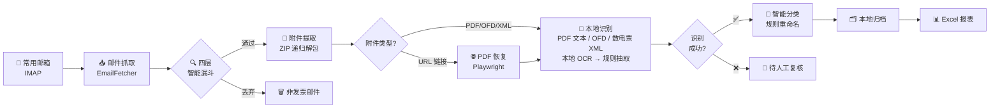
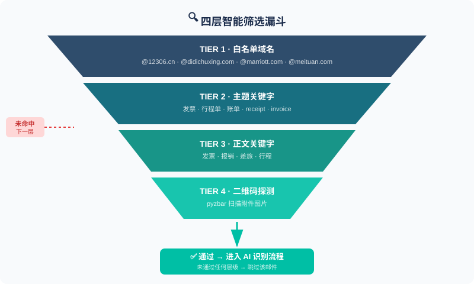
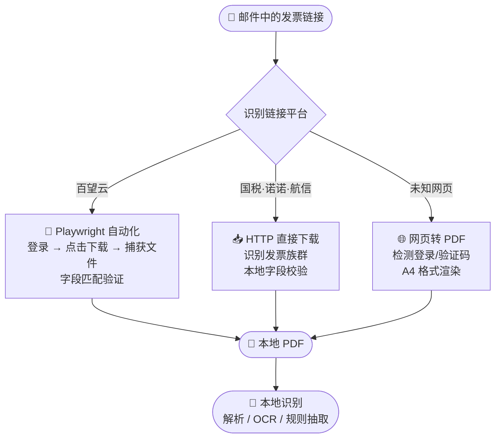

# 整票 — 电子发票整理与报销准备工具

<div align="center">

[English](README.en.md) | **中文**

</div>


<div align="center">


**把邮箱中的 PDF、OFD、XML 电子发票和部分发票下载链接，整理成分类文件与 Excel 报销汇总。**

面向每月需要手工收集多张电子发票的个人、自由职业者和小团队。连接自己的常用邮箱后，可批量收集发票、本地解析与 OCR 识别、分类归档并生成汇总；无法可靠识别的内容保留给用户人工复核。

下载：[最新 Windows（安装版 / 免安装版）与 macOS（Apple Silicon）安装包](https://github.com/woniu-zk/tidyinvoice/releases/latest)

*邮件和发票文件全程在本地处理：电子发票直接解析，扫描件与图片由内置的本地 OCR 识别；识别不需要联网、不需要 API Key，发票内容不会上传。*

</div>

<p align="center">
  
</p>

## DeepSeek Harness 插件

`@woniu-zk/dsh-invoice-downloader` 将本地 IMAP 发票下载、本地解析与 OCR、归档和 Excel 汇总带到 DeepSeek Harness 的右侧边栏。适用于希望把重复整理工作交给本地自动化、同时保留人工复核的报销场景。

```powershell
dsh plugin --profile web add @woniu-zk/dsh-invoice-downloader
dsh web --profile web
```

打开右侧的“发票下载”入口，选择保存位置，安装一次本地引擎后填写常用邮箱的 IMAP 授权码。首次安装需要联网下载 Python 依赖和 Chromium；`rapidocr-onnxruntime` 的 pip wheel 自带默认 PP-OCRv3 模型，无需额外手动下载模型。发票文件与识别文本均在本机处理，插件不需要模型或 API Key。插件支持 Windows x64 和 macOS Apple Silicon，授权码由 DSH 凭据服务保存，不写入插件设置或扫描日志。

---

## ✨ 核心亮点

| &nbsp; | 特性 | 说明 |
|--------|------|------|
| 🔒 | **一键运行，开箱即用** | 解压即可运行，无需安装 Python 或任何依赖 |
| 🔎 | **本地识别引擎** | PDF 文本层、OFD 与数电票 XML 直接解析，扫描件与图片走内置本地 OCR，无需联网与 API Key |
| 🔍 | **四层智能漏斗** | 白名单域名 → 主题关键字 → 正文检测 → 二维码扫描，精准过滤非发票邮件 |
| 📄 | **链接发票自动恢复** | Playwright 自动打开百望云、税务平台链接，下载正式 PDF 存档 |
| 🧾 | **发票与凭证自动撮合** | 住宿发票/水单、打车发票/行程单自动配对并相邻命名归档 |
| 🪟 | **安静的后台处理** | URL 恢复 worker、Node 与 Chromium 全链路隐藏运行，不再批量弹出控制台窗口 |
| 🗂️ | **开放费用归类规则** | 内置默认 + 用户规则 + 全局自定义票种 + 销售方词典 + 规则包；目标票种和金额范围自动生成归档文件夹，未命中进复核 |
| 📂 | **本地文件夹整理** | 不连邮箱也能用：手机导出、微信/支付宝下载、拍照发票等任意文件夹一键离线整理；默认在原文件夹内分类归档，原件按原文件名原样保留在 `整理前发票/` |
| 📥 | **仅提取到 inbox** | 只把附件与来源清单保存到 `inbox/`，不做识别和改名，方便交给自己的工具或后续整理 |
| 📊 | **一键 Excel 报表** | 自动生成 `结果明细_<时间戳>.xlsx`，发票清单、金额汇总全覆盖 |

---

## 🏗️ 整体工作流程



---

## 🔎 本地识别链路

识别全程在本机完成，按「确定性解析优先 → 本地 OCR 兜底 → 规则抽取与校验」的顺序处理，不需要联网、不需要 API Key，也不调用任何模型服务。

> **识别顺序**
> - **文本层 PDF**：用 PyMuPDF 直接读取版式文本，不经过 OCR
> - **OFD / 数电票 / 增值税 XML**：按容器结构与字段别名直接解析
> - **扫描件与图片**：交给内置的本地 OCR（RapidOCR + ONNX Runtime，模型随依赖提供）
> - **规则抽取**：按锚点与正则规则映射票面字段，例如金额按「价税合计（大写）/（小写）」锚点定位
>
> **离线一致性校验**：核对合计金额 + 税额与价税合计的勾稽关系、日期是否可解析、票号是否为合法数字串；无法确认时不猜测，转入「待人工复核」由用户核对。

---

## 🧩 费用归类规则

费用类目不再写死在代码里。内置规则只提供出厂默认值，用户可以在界面里新增规则，选择或新建目标票种，填写关键词和金额范围，也可以用文本编辑器或命令行维护同一套规则。

- **规则位置**
  - 全局规则：`%APPDATA%\TidyInvoice\rules\`（macOS 为 `~/Library/Application Support/TidyInvoice/rules/`）
  - 当前发票库覆盖：`<发票库>\rules\`
  - 文件：`categories.yaml`（规则与关键词）、`custom_types.yaml`（全局自定义票种）、`user_terms.yaml`（销售方 → 类目）、`rules.d/*.yaml`（可选规则包）
- **生效顺序**：当前发票库规则 → 全局规则 → 内置默认规则；同一范围内按列表从上到下匹配，首条命中即定，不再需要配置优先级。
- **一条规则只需要填**：目标票种、关键词、金额范围（可选）、是否启用。归档文件夹不用手填，直接由“目标票种 + 金额范围”生成。
- **目标票种**：可以使用内置票种（打车、住宿发票、餐饮等），也可以在任意作用范围新建自定义票种。自定义票种写入全局 `custom_types.yaml`，全局规则和所有发票库规则都能选用；被规则引用时不能删除。
- **文件夹命名**：目标票种“酒店”、金额 100–200 生成 `酒店-100-200/`；只有下限生成 `酒店-100以上/`，只有上限生成 `酒店-200以下/`，不填金额则直接使用 `酒店/`。
- **匹配原则**：先查销售方词典，再按关键词 + 金额匹配用户规则；命中后归入规则选择的目标票种。最后用内置默认规则兜底；全部未命中时标记为未分类并进入「待人工复核」，不会硬塞进「其他」。
- **票种与识别的关系**：内置票种是软件从票面识别出的结果；自定义票种是用户定义的规则输出类型，不会被识别阶段直接产生，但可以给任意关键词规则指定为目标票种。
- **内置默认规则也可以修改**：内置类目的目标票种、关键词、金额范围和启用状态都可以改，修改保存为当前范围的覆盖。页面提供单条和全部「恢复默认」，点击后需要二次确认，并可选择“仅当前作用范围”或“全局 + 当前发票库”；恢复前会自动备份。内置规则仍保留内部票种兜底条件，不会被界面覆盖。
- **为什么归到这一类**：界面“规则测试”和 `rules test` / `rules explain` 会给出命中的词典/规则、关键词、目标票种、归档文件夹和规则文件行号。
- **保存与回滚**：界面或命令行修改前自动备份到 `rules/.backup/`，可一键恢复当前范围的默认规则；直接编辑 YAML 后下一次整理自动生效，无需重启。

示例：新建目标票种“酒店”，新增规则关键词“酒店住宿”、金额 100–200，自动归档到 `酒店-100-200/`。整理后 150 元的酒店票进入该文件夹，90 元的仍按票种进入 `住宿发票/`。规则决定归档文件夹，文件名仍保留票种信息。

图形界面入口：**启动配置 → 费用归类规则**。命令行：

```powershell
python organize_cli.py rules list
python organize_cli.py rules test --text "酒店住宿" --amount 150.00
python organize_cli.py rules types add 酒店
python organize_cli.py rules add-rule 酒店住宿 --type 酒店 --amount-min 100 --amount-max 200
python organize_cli.py rules validate
```

> 在界面保存会重写当前范围的规则文件；如果希望保留 YAML 注释，请直接编辑文件。当前发票库规则优先于全局规则，恢复库内默认后会回落到全局/内置规则。修改目标票种、关键词或金额范围后，之后的新归档进入新文件夹，旧归档文件不会自动搬家。

---

## 🔍 四层智能筛选漏斗

系统不会对每封邮件都进入识别流程，而是先经过四层漏斗精准判断，减少无效识别与误判。



筛选通过后，附件还会经过 **三级决策**：

| 层级 | 触发条件 | 处理方式 |
|------|----------|----------|
| 🗑️ **A 层**（丢弃） | Tracking pixel、Logo、装饰图（≤32px） | 直接跳过 |
| 📦 **B 层**（暂存） | 附件 >5MB、ZIP 解包失败 | 保留但不处理 |
| ✅ **C 层**（归档） | 正常 PDF/OFD/XML | 进入本地识别流程 |

---

## 🌐 三级 PDF 恢复方案

许多发票邮件只有"点击下载"的链接，系统自动识别平台并选择最优方案：



---

## 📂 三种使用方式：提取与整理可以分开用

| 方式 | 适合场景 | 做什么 |
|------|----------|--------|
| **邮箱提取并整理** | 常规用法 | 连接邮箱，提取附件后识别、分类、重命名并归档 |
| **仅提取到 inbox** | 已有自己的整理工具 | 只把发票附件保存到 `inbox/`，并生成来源清单 `manifest.jsonl`；不做识别、不改名、不写台账 |
| **本地文件夹整理** | 发票已经在电脑里 | 选择任意文件夹（手机导出、微信/支付宝下载目录、纸质票照片），点击「开始整理」后离线识别并自动分类、重命名、归档到该文件夹内 |

- 「本地文件夹整理」**不需要任何邮箱配置，也不联网**，一键执行，不需要先预览确认。
- 「仅提取」与「本地文件夹整理」只通过 `inbox/` + `manifest.jsonl` 交接；本地整理会读取清单里的来源信息（邮箱、主题、发件人、收到时间等）并随归档保留。
- 「本地文件夹整理」默认在**所选发票文件夹本身**整理，输出目录默认与发票文件夹相同（也可改为其他目录）：
  - 分类命名副本放入 `打车/` `住宿发票/` 等分类文件夹；
  - **原文件原样保留在 `整理前发票/` 文件夹**：文件名、文件内容和原有子目录位置都不改，不按月份分目录，也不会删除；
  - 重复文件移入 `duplicates/`；
  - 结果明细 Excel 写入整理目录；无法处理的文件留在原位。
- 再次对同一文件夹执行整理是**幂等**的：已整理文件不会被重复归档或重复识别。

### 命令行（可选）

仓库根目录提供独立命令行入口，便于脚本化，也可与其他工具串联：

```powershell
# 只整理本地文件夹：默认预览，--apply 才真正执行（默认输出到原文件夹，即同目录整理）
python organize_cli.py organize "D:\发票\待整理"
python organize_cli.py organize "D:\发票\待整理" --apply

# 也可以显式指定其他归档库（此时只复制归档副本，原文件保留在原文件夹）
python organize_cli.py organize "D:\发票\待整理" --output "D:\发票库" --apply

# 只提取邮箱附件到 inbox（不解析、不归档；授权码支持 env:变量名）
python organize_cli.py fetch --email you@qq.com --auth-code env:QQ_AUTH_CODE --output "D:\发票库"
```

`manifest.jsonl` 每行记录一个附件的来源信息（`sha256`、相对路径、邮箱、UID、主题、发件人、收到时间等），格式公开、可手工编辑，也可被其他脚本读取。

---

## ⚙️ 配置指南

> 首次使用只需配置一次（邮箱地址与授权码），之后每次扫描直接点击运行；识别引擎已内置，无需模型或 API Key。

### 支持的邮箱

| 服务 | 域名 | IMAP 服务器 | 授权方式 |
|------|------|-------------|----------|
| QQ 邮箱 | `qq.com` / `vip.qq.com` / `foxmail.com` | `imap.qq.com` | 授权码 |
| 163 / 126 / 188 邮箱 | `163.com` / `126.com` / `188.com` | `imap.163.com` / `imap.126.com` / `imap.188.com` | 授权码 |
| Yeah 邮箱 | `yeah.net` | `imap.yeah.net` | 授权码 |
| 网易企业邮 | `qiye.163.com` | `imap.qiye.163.com` | 客户端专用密码 |
| 88 邮箱 | `88.com` | `imap.88.com` | 专用密码 |
| 腾讯企业邮 | `exmail.qq.com` | `imap.exmail.qq.com` | 客户端专用密码 |
| 新浪邮箱 | `sina.com` / `sina.cn` | `imap.sina.com` | 客户端授权码 |
| 搜狐邮箱 | `sohu.com` | `imap.sohu.com` | 授权码 |
| 21CN 邮箱 | `21cn.com` | `imap.21cn.com` | 授权码 |
| 263 邮箱 | `263.net` | `imap.263.net` | 客户端密码 |
| 189 / 139 邮箱 | `189.cn` / `139.com` | `imap.189.cn` / `imap.139.com` | 授权码 |
| 阿里邮箱 | `aliyun.com` / `qiye.aliyun.com` | `imap.aliyun.com` / `imap.qiye.aliyun.com` | 专用密码 |
| Gmail | `gmail.com` / `googlemail.com` | `imap.gmail.com` | 应用专用密码（需先开启两步验证） |
| iCloud 邮箱 | `icloud.com` / `me.com` / `mac.com` | `imap.mail.me.com` | App 专用密码（需先开启双重认证） |
| Yahoo 邮箱 | `yahoo.com` / `ymail.com` | `imap.mail.yahoo.com` | 应用密码 |
| Zoho / Yandex / GMX / AOL / Fastmail | `zoho.com` / `yandex.com` / `gmx.net` / `gmx.com` / `aol.com` / `fastmail.com` | `imap.zoho.com` / `imap.yandex.com` / `imap.gmx.net` / `imap.gmx.com` / `imap.aol.com` / `imap.fastmail.com` | 应用密码 |

- 全部邮箱统一使用 `993` 端口与 SSL/TLS 加密连接。
- 网易系邮箱（163、126、188、yeah.net、网易企业邮）与 88 邮箱会自动处理 IMAP ID 命令，无需手工设置。
- 国际邮箱需要先在邮箱后台开启两步验证或双重认证，再用生成的应用专用密码/应用密码登录，不能填账户登录密码。
- Outlook.com、Hotmail、Microsoft 365 / Exchange 企业邮，以及 Proton Mail、Tutanota 暂不支持，原因见常见问题；自定义企业域可在命令行用 `--imap-host` 指定 IMAP 服务器。

### 示例 · 163 邮箱

<details>
<summary>📖 点击展开 163 邮箱详细步骤</summary>

**服务器参数**

| 参数 | 值 |
|------|----|
| IMAP 服务器 | `imap.163.com` |
| 端口 | `993`（SSL/TLS） |

**开启步骤**

1. 登录 [mail.163.com](https://mail.163.com)，点击右上角「**设置**」
2. 在下拉菜单中选择「**POP3/SMTP/IMAP**」
3. 找到「**IMAP/SMTP 服务**」，点击右侧「**开启**」按钮
4. 弹出「账号安全验证」窗口：
   - **扫码方式**（推荐）：手机扫描二维码，自动发送验证短信
   - **手动方式**：按提示手动发送短信到指定号码
5. 短信发送后点击「**我已发送**」
6. 系统生成 **16 位授权码**（字母组合，**仅显示一次，务必立即复制保存**）

> ⚠️ 授权码不是邮箱登录密码，是专用于第三方客户端的独立密码，大小写敏感。

📚 [163 邮箱官方帮助](https://help.mail.163.com/)

</details>

---

### 示例 · QQ 邮箱

<details>
<summary>📖 点击展开 QQ 邮箱详细步骤</summary>

**服务器参数**

| 参数 | 值 |
|------|----|
| IMAP 服务器 | `imap.qq.com` |
| 端口 | `993`（SSL/TLS） |

**开启步骤**

1. 登录 [mail.qq.com](https://mail.qq.com)，点击右上角「**设置**」图标
2. 选择「**账户**」选项卡
3. 找到「**POP3/IMAP/SMTP/Exchange/CardDAV/CalDAV 服务**」
4. 点击「**管理服务**」→「**开启服务**」
5. 点击「**生成授权码**」，进行身份验证：
   - **扫码方式**（推荐）：手机扫码后自动发送验证短信
   - **手动方式**：用 QQ 绑定手机发送「**配置邮件客户端**」到 **1069070069**
6. 点击「**我已发送**」，验证后授权码即时生成（**请立即保存**）

> ⚠️ 修改 QQ 密码后授权码自动失效，需重新生成。

📚 [QQ 邮箱官方帮助](https://service.mail.qq.com/detail/0/339)

</details>

---

### 示例 · 88 邮箱

<details>
<summary>📖 点击展开 88 邮箱详细步骤</summary>

**服务器参数**

| 参数 | 值 |
|------|----|
| IMAP 服务器 | `imap.88.com` |
| 端口 | `993`（SSL/TLS） |
| 用户名 | 完整邮箱地址 |
| 密码 | 邮箱后台生成的专用密码 |

**开启步骤**

1. 登录 [mail.88.com](https://mail.88.com)，进入「**设置**」→「**POP 设置**」
2. 确认 **IMAP/SMTP 服务**已开启
3. 找到「**专用密码**」区域，点击「**新增专用密码**」
4. 输入名称（例如 `整票`），生成后立即复制随机密码
5. 在软件中填写完整邮箱地址，并将该专用密码填入授权码一栏

> ⚠️ 专用密码不是邮箱登录密码。它专用于第三方邮件客户端，请单独保存。

</details>

---

## 🚀 快速开始

### Windows（安装版 / 免安装版）

1. 安装版：运行 `TidyInvoice-*-windows-x64-setup.exe`；免安装版：解压 `TidyInvoice-*-windows-x64-portable.zip` 到普通文件夹（避免云盘同步目录），并保持 `_internal` 文件夹与 `TidyInvoice.exe` 同级。
2. 双击 `TidyInvoice.exe`；首次启动会自动弹出设置界面。
3. 填入邮箱地址与授权码（常用邮箱），保存后点击「开始扫描」。识别在本机离线运行，扫描件与图片由内置 OCR 处理，无需联网或 API Key；发票会自动归档到桌面「发票整理」文件夹。

### macOS（Apple Silicon）

1. 打开 `TidyInvoice-*-macos-arm64.dmg`，将 `TidyInvoice` 拖入“应用程序”文件夹。
2. 首次启动会自动弹出设置界面。此版本未签名、未公证；若 macOS 阻止打开，请在“系统设置 → 隐私与安全性”中确认仍要打开。
3. 填入邮箱地址与授权码（常用邮箱），保存后点击「开始扫描」。识别在本机离线运行，扫描件与图片由内置 OCR 处理，无需联网或 API Key。

---

## 📁 输出目录结构

```
发票整理/
├── inbox/             ← 仅提取模式的交接目录（含 manifest.jsonl 来源清单）
├── 火车票/
│   └── 20260315-北京-上海-火车票.pdf
├── 机票/
│   └── 20260301_机票_1280.00_中国国际航空.pdf
├── 住宿发票/
│   ├── 20260310-住宿-01-发票_888.00元.pdf
│   └── 20260310-住宿-01-水单_888.00元.pdf
├── 打车/
│   ├── 0312-滴滴-01-发票_45.50元.pdf
│   └── 0312-滴滴-01-行程单_45.50元.pdf
├── 餐饮/
├── 待人工复核/        ← 无法可靠确认的材料，需人工处理
├── 非目标公司发票/
└── 结果明细_<时间戳>.xlsx
```

---

## ❓ 常见问题

<details>
<summary>Q：软件启动后白屏或无响应？</summary>

- 确认已将**整个压缩包解压**，`_internal` 文件夹须与 `TidyInvoice.exe` 在同一目录
- 避免将软件放在含有**中文路径或空格**的目录下

</details>

<details>
<summary>Q：扫描完发票数量很少？</summary>

- 在软件的时间范围设置中，将起始日期**往前调整至 180 天以上**
- 部分邮箱默认只拉取近30天邮件，需要在邮箱 IMAP 设置里选择「收取全部邮件」

</details>

<details>
<summary>Q：授权码填写后提示认证失败？</summary>

- **QQ 邮箱 / Foxmail / 腾讯企业邮**：QQ 与 Foxmail 须从「管理服务 → 生成授权码」流程获取，**不是 QQ 密码**；腾讯企业邮使用客户端专用密码
- **163 / 126 / 188 / yeah.net**：须从「开启 IMAP 服务」弹窗中生成，**不是邮箱登录密码**，注意大小写
- **网易企业邮（`qiye.163.com`）与 88 邮箱**：使用邮箱后台生成的客户端专用密码/专用密码，**不是邮箱登录密码**
- **新浪、搜狐、21CN、263、139、189、阿里邮箱**：新浪用客户端授权码，搜狐、21CN、139（移动）、189（电信）用授权码，263 用客户端密码，阿里邮箱用专用密码
- **Gmail、iCloud、Yahoo、Zoho、Yandex、GMX、AOL、Fastmail**：必须使用应用专用密码（Gmail 需先开启两步验证，iCloud 需先开启双重认证），账户登录密码一律无效
- QQ 修改密码后需重新生成授权码

</details>

<details>
<summary>Q：Outlook、企业 Exchange 或其他邮箱能连吗？</summary>

暂不支持 Outlook.com、Hotmail、Live、MSN 邮箱，以及 Microsoft 365 / Exchange 企业邮：这些服务要求 OAuth2 现代认证，无法用授权码方式连接。Proton Mail 需要在本机运行 Bridge、Tutanota 不提供 IMAP，同样无法直接连接。未在支持列表中的域名会明确提示不支持，不会尝试连接其他邮箱服务器；自定义企业域可在命令行用 `--imap-host` 指定 IMAP 服务器。

</details>

<details>
<summary>Q：识别需要联网或填写 API Key 吗？</summary>

不需要。电子发票由本机直接解析，扫描件与图片由内置的本地 OCR 识别，模型随软件提供；识别过程不联网、不调用模型服务，也不需要填写 API Key。

</details>

<details>
<summary>Q：部分发票进入「待人工复核」文件夹？</summary>

正常现象。当本地解析与规则校验无法可靠确认时，系统自动放入「待人工复核」目录，需人工确认。通常由图片模糊、非标准票据或加密 PDF 导致。

</details>

<details>
<summary>Q：为什么有些发票显示“未命中归类规则”？</summary>

费用类目全部规则都没有命中时，系统会把发票标记为「未分类」并放入「待人工复核」，而不是硬塞进「其他」。到 **启动配置 → 费用归类规则** 补充一条销售方/项目关键词、票种或金额规则，保存后把该文件移回发票文件夹重新整理即可按新规则归档。

</details>

<details>
<summary>Q：规则里的「目标票种」是做什么的？</summary>

目标票种是这条规则命中后归入的类型，同时决定归档文件夹和归类结果。可以使用内置票种（打车、住宿发票、餐饮等），也可以新建自定义票种。内置票种是软件从票面识别出的类型；自定义票种是用户定义的规则输出类型，创建后全局可用，不会被识别阶段直接产生，但可以给任意关键词规则指定。

</details>

<details>
<summary>Q：归档文件夹名是怎么来的？</summary>

不需要手动填写，由“目标票种 + 金额范围”生成：目标票种“酒店”、金额 100–200 会生成 `酒店-100-200/`；只有下限生成 `酒店-100以上/`，只有上限生成 `酒店-200以下/`，不填金额则直接使用 `酒店/`。修改目标票种、关键词或金额范围后，之后的新归档进入新文件夹，旧文件不会自动搬家。

</details>

<details>
<summary>Q：内置规则可以修改吗？恢复默认安全吗？</summary>

可以。内置规则支持修改目标票种、关键词、金额范围和启用状态，保存后会成为当前作用范围的覆盖。单条规则和“全部恢复默认”都会先弹出确认框，可选择“仅当前作用范围”或“全局 + 当前发票库”；确认后才会删除覆盖并恢复内置默认，恢复前会自动备份原规则文件。

</details>

<details>
<summary>Q：分类规则文件在哪里？可以自己改吗？</summary>

可以。全局规则在 `%APPDATA%\TidyInvoice\rules\`（macOS 为 `~/Library/Application Support/TidyInvoice/rules/`），当前发票库的覆盖规则在 `<发票库>\rules\`。规则是开放的 YAML：`categories.yaml`、全局自定义票种 `custom_types.yaml`、`user_terms.yaml` 和可选的 `rules.d/*.yaml`。每次保存前会自动备份到 `.backup/`，界面和命令行都可以恢复默认。

</details>

---

## 🛡️ 隐私与安全

- 所有邮件、发票文件均在**本地处理**，不上传任何服务器
- 邮箱凭据在 Windows 通过 **DPAPI** 加密存储，在 macOS 通过 **Keychain** 存储
- 识别全程在本机完成：电子发票直接解析，扫描件与图片由内置 OCR 处理；不调用模型服务，也不发送发票内容

---

## ⚠️ 免责声明

使用本软件即表示您已理解并接受以下内容。

**合规使用** · 本软件通过 IMAP **只读**访问邮箱，不发送、删除或修改任何邮件。用户须确保对所处理邮箱拥有合法授权。

**用途** · 本软件仅用于发票邮件下载、识别、分类、归档等自动化辅助。

**准确性与合规性** · 作者不保证发票数据或生成结果的准确性、完整性、合法性、税务合规性、财务合规性或会计合规性。用户必须自行核验所有发票、报销、税务、会计和合规结果后再使用。

**数据** · 识别与归档在本机完成，不调用外部模型服务，发票文件与识别文本不会上传到第三方；邮件原文也不会被发送。

**责任限制** · 作者不对使用本软件造成的损失、遗漏、错误、报销失败、税务风险、合规问题或数据丢失承担责任。

**第三方服务**

| 服务 | 用途 | 服务方 |
|------|------|--------|
| 腾讯系邮箱 IMAP（QQ 邮箱、Foxmail、腾讯企业邮） | 邮件读取 | 腾讯 |
| 网易系邮箱 IMAP（163、126、188、yeah.net、网易企业邮） | 邮件读取 | 网易 |
| 88 邮箱 IMAP | 邮件读取 | 完美世界 |
| 阿里邮箱 IMAP | 邮件读取 | 阿里云 |
| 新浪邮箱 IMAP | 邮件读取 | 新浪 |
| 搜狐邮箱 IMAP | 邮件读取 | 搜狐 |
| 21CN 邮箱 IMAP | 邮件读取 | 21CN |
| 263 邮箱 IMAP | 邮件读取 | 263 |
| 139 邮箱 IMAP | 邮件读取 | 中国移动 |
| 189 邮箱 IMAP | 邮件读取 | 中国电信 |
| Gmail IMAP | 邮件读取 | Google |
| iCloud 邮箱 IMAP | 邮件读取 | Apple |
| Yahoo 邮箱 IMAP | 邮件读取 | Yahoo |
| Zoho 邮箱 IMAP | 邮件读取 | Zoho |
| Yandex 邮箱 IMAP | 邮件读取 | Yandex |
| GMX 邮箱 IMAP | 邮件读取 | GMX |
| AOL 邮箱 IMAP | 邮件读取 | AOL |
| Fastmail IMAP | 邮件读取 | Fastmail |

以上服务仅通过 IMAP 以只读方式读取邮件，不发送、不删除、不修改任何邮件。

---

## 🌱 来源与致谢

本项目是 [Invoice Downloader](https://github.com/EthanYoQ/Invoice-Downloader)（作者 EthanYoQ / Yong Qi，Apache License 2.0）的衍生项目，在其基础上继续开发与维护。我们保留上游的版权、许可与 [NOTICE](NOTICE) 署名，并沿用同一许可证。

本项目由社区独立维护，与上游作者无隶属关系，也未获得上游的背书或认证；产品名称、图标、发布包与 npm 包均不代表上游。上游项目自身的问题请提交到上游仓库，本项目引入的问题请提交到[本仓库议题](https://github.com/woniu-zk/tidyinvoice/issues)。

通用改进会尽量整理成可回推上游的补丁，详见 [docs/UPSTREAM.md](docs/UPSTREAM.md)。

---

## 📜 许可证

本仓库**自有代码**基于 [Apache License 2.0](LICENSE) 授权：允许商业使用、修改、分发和闭源集成；再分发时须保留版权声明、许可文本、[NOTICE](NOTICE) 归属与第三方声明。

发布的安装包包含 **AGPL-3.0 组件 PyMuPDF**，因此分发物需按 AGPL-3.0 向接收者提供对应源码；安装包内附 `LICENSE`、`NOTICE`、`THIRD_PARTY_NOTICES.md` 与 `licenses/`。许可结构、可做与不可做、商业许可路径见 [docs/LICENSING.md](docs/LICENSING.md)，第三方组件清单见 [THIRD_PARTY_NOTICES.md](THIRD_PARTY_NOTICES.md)。

---

<div align="center">

Made with ❤️ by **蜗牛**

[报告问题](https://github.com/woniu-zk/tidyinvoice/issues) · [163邮箱帮助](https://help.mail.163.com/) · [QQ邮箱帮助](https://service.mail.qq.com/detail/0/339)

</div>
