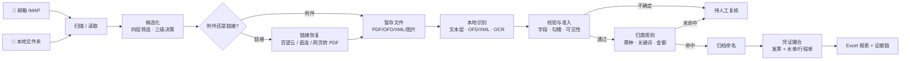
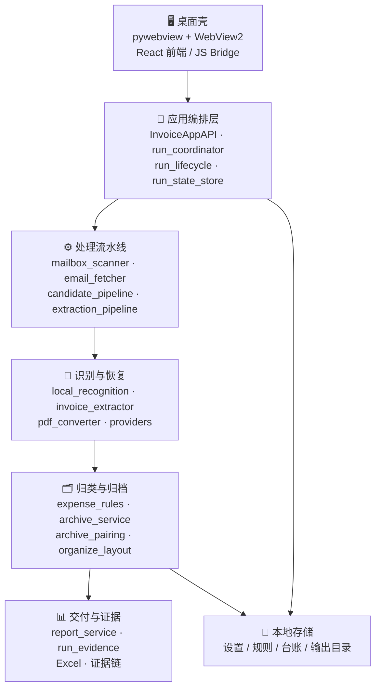

# 整票 功能总览

> **一句话**：把邮箱或本地文件夹里的电子发票（PDF / OFD / XML / 图片 / 下载链接），整理成分类目录 + 可复核的 Excel 报销汇总。识别全程离线，邮箱只读访问。
>
> 文档基于当前仓库工作区（2026-11-19，含未提交改动）整理；功能描述以代码实际行为为准，末尾附关键文件索引与统计口径。

---

## 目录

1. [项目是什么](#1-项目是什么)
2. [它解决什么问题](#2-它解决什么问题)
3. [三种使用方式](#3-三种使用方式)
4. [功能全景](#4-功能全景)
5. [端到端处理流水线](#5-端到端处理流水线)
6. [本地识别引擎](#6-本地识别引擎)
7. [链接发票恢复](#7-链接发票恢复)
8. [四层邮件筛选与附件决策](#8-四层邮件筛选与附件决策)
9. [费用归类规则](#9-费用归类规则)
10. [发票与凭证撮合](#10-发票与凭证撮合)
11. [输出目录与报表](#11-输出目录与报表)
12. [系统架构](#12-系统架构)
13. [配置、状态与数据位置](#13-配置状态与数据位置)
14. [安全与隐私](#14-安全与隐私)
15. [工程质量与发布](#15-工程质量与发布)
16. [快速上手](#16-快速上手)
17. [设计取舍与已知边界](#17-设计取舍与已知边界)
18. [关键文件索引](#18-关键文件索引)

---

## 1. 项目是什么

**整票（AI 发票管家）** 是一款本地优先的电子发票整理与报销准备工具，面向每月需要手工收集多张电子发票的个人、自由职业者和小团队。

它做三件事：

| 阶段 | 做什么 | 结果 |
|------|--------|------|
| **收集** | 通过 IMAP 只读读取常用邮箱，或扫描任意本地文件夹 | 发票原始文件进入处理流水线 |
| **理解** | 本地解析 PDF 文本层、OFD、数电票 XML，扫描件与图片走本地 OCR，再用规则抽取票面字段 | 日期、金额、销售方、票种、发票号等结构化数据 |
| **交付** | 按费用规则分类、标准化命名、归档；生成 Excel 明细并标记待复核项 | 分类文件夹 + Excel + 待人工复核清单 |

产品承诺：

- **识别不联网**：不调用模型服务，不需要 API Key，发票文件与识别文本不出本机。
- **邮箱只读**：只拉取邮件，不发送、不删除、不修改。
- **仓库是完整产品**：桌面应用、CLI、Windows/macOS 发布构建，以及 DeepSeek Harness 侧边栏插件都在同一个仓库维护。

**规模画像**（当前工作区统计）：约 104k 行 Python（158 个 `.py`，含测试），根目录 50 个业务模块；`pytest` 收集到 **1388 个测试**；支持 18 种票据/辅助类型、3 级链接恢复（7 类直连平台 + 百望云）、多种常用邮箱。

---

## 2. 它解决什么问题

| 痛点 | 项目中的机制 | 用户看到的结果 |
|------|--------------|----------------|
| 发票散落在几个月、几百封邮件里 | IMAP 按日期范围批量扫描 + 四层邮件筛选 | 只处理可能是发票的邮件，避免整箱全量识别 |
| 邮件只有「点击下载」链接 | 三级链接恢复：百望云自动化、税务平台 HTTP 直连、网页转 PDF | 链接变成可归档的本地 PDF |
| 扫描件、拍照发票没有文字层 | 本地 OCR（RapidOCR + ONNX Runtime，模型随依赖提供） | 图片也能抽取票面字段 |
| 文件名乱、分类靠手工 | 开放规则引擎 + 标准命名 + 归档目录 | `20260315_打车_103.00_上海滴滴….pdf` 这类可检索文件名 |
| 发票和水单、行程单对不上 | 打车↔行程单、住宿↔水单自动撮合与并排命名 | 同一笔报销的主凭证和附件相邻存放 |
| 报销汇总要手工复制粘贴 | Excel 明细：分类汇总 / 成功明细 / 异常记录 | 一键导出，可直接交给财务或自己核对 |
| 担心发票被上传到云端 | 本地解析 + 离线 OCR + 本地凭据加密 | 无云端存储、无模型调用 |
| 重复下载、重复整理 | 文档指纹 + 发票业务键 + 目录布局迁移 | 重复文件进 `duplicates/`，二次整理不重复归档 |
| 无法确认识别是否可靠 | 勾稽校验 + 独立产物验证 + 待人工复核 | 不确定的材料不硬猜，进入复核目录 |

---

## 3. 三种使用方式

桌面端首页提供三种任务动作，入口、是否识别、是否归档都是独立的：

| 模式 | 适用场景 | 做什么 | 不做什么 |
|------|----------|--------|----------|
| **邮箱提取并整理** | 常规用法 | 连接邮箱 → 提附件/恢复链接 → 本地识别 → 按规则分类、重命名、归档 → Excel | — |
| **邮箱提取** | 已有自己的整理工具 | 只把发票附件保存到 `inbox/`，并写 `manifest.jsonl` 来源清单 | 不识别、不改名、不归档、不写台账 |
| **本地整理** | 发票已在电脑里（手机导出、微信/支付宝下载、拍照） | 扫描任意文件夹 → 离线识别 → 分类副本 + 原件原样保留 + Excel | 不需要邮箱，不联网 |

三个模式共享同一套识别、规则、归档和报表代码；「邮箱提取」与「本地整理」之间只通过 `inbox/` + `manifest.jsonl` 交接，方便把收集与整理拆开使用。

**本地整理**的关键行为：

- 默认输出到**所选文件夹本身**（原地整理），分类文件写入 `打车/`、`住宿发票/` 等子目录；
- 原件按原文件名、原内容、原相对路径保留在 `整理前发票/`，不改名、不分月份、不删除；
- 重复文件移入 `duplicates/`；无法处理的留在原位并记录；
- 再次整理幂等：工具自己产出的文件不会被二次归档；
- 支持「按分类建子目录 / 平铺」两种布局，切换布局时会迁移上一轮产物；
- 桌面端点击「本地整理」直接执行，不要求先预览；命令行 `organize` 默认只预览，加 `--apply` 才真正落盘。

---

## 4. 功能全景

### 4.1 采集

- **邮箱支持**：QQ、网易（163 / 126 / 188 / yeah.net / 网易企业邮）、88、腾讯企业邮、阿里、新浪、搜狐、21CN、263、139 / 189，以及 Gmail、iCloud、Yahoo、Zoho、Yandex、GMX、AOL、Fastmail，统一 993 SSL/TLS；网易系与 88 自动处理 IMAP ID 命令，国际邮箱需使用应用专用密码。
- **日期范围**：可指定起止日期，按邮件头日期过滤。
- **附件处理**：ZIP 递归解包（限制成员数、单文件与总解压体积、嵌套层数），PDF/OFD/XML/图片直取。
- **邮件正文回执**：部分平台（iCloud、百望云、票易通等）把发票信息写在邮件正文，可解析成候选记录。
- **静默后台**：URL 恢复 worker、Node、Chromium 在隐藏子进程运行，避免批量弹窗。

### 4.2 筛选与准入

- **四层邮件筛选**：域名白名单 → 主题关键词 → 正文关键词 → 其余，逐层决定是否进入候选。
- **三级附件决策**：A 丢弃（追踪像素、Logo、装饰小图）→ B 暂存（>5MB、ZIP 解包失败等，保留不处理）→ C 进入识别。
- **链接噪声治理**：已知营销/追踪链接、平台产品页、包装页先被识别为噪声；只有可信平台族或强信号链接进入恢复。
- **最终准入**：识别结果还要通过日期、销方、金额、票号、金额勾稽等校验；PDF 产物要验证字段真的可见（不是被图片覆盖的文本层）。

### 4.3 识别

- **确定性解析优先**：文本层 PDF 直接读版式文本；OFD 解 ZIP 后读 `ofd:TextCode`；数电票 XML 直接解析字段。
- **本地 OCR 兜底**：扫描 PDF 渲染前 2 页（200 DPI）后 OCR；图片直接 OCR；二维码作为最后兜底。
- **规则字段抽取**：按锚点与正则定位「价税合计（小写）/（大写）」、日期、票号、销售方、购买方、明细等。
- **票种判定**：18 种文档类型（打车、行程单、火车票、机票、住宿发票、住宿水单、餐饮、过路费、充电、定额发票、差旅服务费、通行费汇总单、开票二维码等），另有非目标公司/个人非报销隔离类型。
- **拒绝猜测**：无法可靠确认时进入「待人工复核」，不硬塞进「其他」。

### 4.4 归类与命名

- **规则可配置**：内置默认 → 全局规则 → 当前发票库规则，逐层覆盖；支持规则包（`rules.d/*.yaml`）。
- **一条规则 = 目标票种 + 关键词 + 金额范围（可选）+ 启用状态**；归档文件夹由「票种 + 金额区间」自动生成。
- **自定义票种**：可新建全局票种，供任意规则选择；被规则引用时不能删除。
- **销售方词典**：按税号精确匹配或名称包含匹配，优先于关键词规则。
- **购买方校验**：可配置公司名；购买方不符的发票分流到「非目标公司发票」，个人非报销票据进入独立隔离目录，避免混进报销库。
- **解释能力**：UI 的「规则测试」和 CLI 的 `rules explain` 会给出命中词典/规则、关键词、目标票种、归档文件夹与规则文件行号。
- **标准命名**：日期 + 票种 + 金额 + 销售方；火车票用「日期-出发-到达-火车票」；配对件用统一序号并排命名。
- **重名与冲突**：预览用 `_2` 后缀，正式落盘用短 UUID，避免覆盖。

### 4.5 发票—凭证撮合

- **打车**：打车发票 ↔ 行程单；**住宿**：住宿发票 ↔ 水单/确认单。
- 按金额（含税率换算容差）、业务日期、同平台、同邮件等信号打分，做全局最优指派；多解时标记歧义，不强行配对。
- 配对成功后改为并排文件名，例如：
  - `0315-滴滴-01-发票_103.00元.pdf` + `0315-滴滴-01-行程单_103.00元.pdf`
  - `20260315-住宿-01-发票_88.00元.pdf` + `20260315-住宿-01-水单_88.00元.pdf`

### 4.6 交付与复核

- **Excel 明细**：分类汇总、成功明细、异常记录三个工作表；字段覆盖日期、金额、销售方、分类、归类来源、命中规则、文件路径、异常原因等。
- **结果页**：本轮成功/待复核/暂存/异常分组、分类汇总、运行摘要、导出入口、开始新批次。
- **人工复核**：待复核文件进入 `待人工复核/`；URL 型无法下载的候选会保留 `.url.txt` 占位证据。
- **打开位置**：直接打开输出目录、待复核目录或选中文件。
- **历史去重**：输出库内保存归档历史与业务记录，跨运行拦截重复发票。

### 4.7 运行与治理

- **运行状态机**：`created → scanning → recovering → extracting → archiving → reporting → finalizing → completed / failed`。
- **安全停止**：停止请求在当前邮件/当前文件处理完后生效，不中断正在写的文件。
- **进度与日志**：首页展示阶段、计数、处理信息与耗时；任务运行期间前端每 1 秒通过本地桥轮询进度，不用 SSE/WebSocket。
- **失败隔离**：单封邮件/单个链接失败记入异常分组，不拖垮整轮；未解决输入会阻止「假成功」收尾。
- **证据链**：每次运行生成不可变证据（输入清单、哈希、归档映射、进程身份），用于事后核查。
- **单实例**：Windows 命名互斥量 / 其他平台锁文件，避免并发启动。

### 4.8 多入口

| 入口 | 说明 |
|------|------|
| Windows 安装版 / 免安装版 | PyInstaller + WebView2，双击即用 |
| macOS Apple Silicon | `.app` + DMG，未签名未公证 |
| 源码启动 | `整票.cmd` / `python main.py`，pywebview 打开本地页面 |
| 命令行 | `organize_cli.py organize / fetch / rules`，可脚本化 |
| DeepSeek Harness 插件 | 右侧边栏内安装本地引擎、配置 IMAP、扫描、归档、Excel |

---

## 5. 端到端处理流水线



| 阶段 | 输入 | 关键动作 | 输出 | 失败去向 |
|------|------|----------|------|----------|
| 扫描 | 邮箱 UID / 目录文件 | IMAP 分段读取、附件解包、SHA-256 | 候选文件 + 来源元数据 | 跳过 / unresolved |
| 候选化 | 邮件、附件名、链接 | 四层筛选、三级决策、供应商族识别 | `DocumentCandidate` | 丢弃 / 仅保全 |
| 恢复 | 发票链接 | 平台识别、Playwright/HTTP 下载、字段比对 | 本地 PDF/XML | 暂存 / 复核 |
| 识别 | 候选文件 | PDF 文本、OFD、XML、OCR、二维码、锚点抽取 | 统一字段 payload | `needs_remote` / 复核 |
| 校验 | 字段 + PDF | 金额勾稽、日期、票号、可见性、购买方归属 | 接受 / 拒绝 | 待复核 / 隔离 |
| 归类 | 字段 + 规则集 | 词典 → 规则 → 票种兜底 → 未命中 | 归档目录 + 分类 | 待复核 |
| 归档 | 归类结果 | 去重、重命名、配对、目录布局 | 分类文件 + 台账 | duplicates / 复核 |
| 报表 | 本轮结果 | 汇总、异常分组、Excel 导出 | `.xlsx` + 运行证据 | — |

---

## 6. 本地识别引擎

识别顺序是「确定性优先、OCR 兜底」，全部在本机完成：

1. **文本层 PDF**：PyMuPDF 直接读取版式文本，不经过 OCR。
2. **OFD**：ZIP 容器 + `ofd:TextCode` 文本提取。
3. **数电票 / 增值税 XML**：按字段别名直接解析。
4. **扫描 PDF / 图片**：渲染前 2 页（200 DPI）→ RapidOCR（PP-OCR ONNX 模型随 wheel 提供）。
5. **二维码兜底**：票面/小票中的开票二维码用于补充或定位。
6. **规则抽取**：按「价税合计」「发票号码」「开票日期」等锚点映射字段。
7. **一致性校验**：合计金额 + 税额与价税合计勾稽、日期可解析、票号是合法数字串；不确定就转「待人工复核」。

**离线保证**：识别模块不访问网络、不需要 API Key、不调用模型服务；OCR 引擎懒加载，加载失败会给出明确原因并降级到复核，而不是静默产出假数据。

**进入「待人工复核」的常见原因**：图片模糊、非标准票据、加密 PDF、金额勾稽不平、销方/购买方无法确认、预过滤判为低置信度、未命中任何归类规则。

---

## 7. 链接发票恢复

很多发票邮件只有「点击下载」链接。系统先按链接域名/路径识别平台族，再选择最优恢复策略：

| 级别 | 触发 | 做法 | 结果 |
|------|------|------|------|
| 百望云 | `baiwang` 家族链接 | 先探测预览 API / 直连产物，再用 Playwright 打开页面捕获下载 | 正式 PDF/XML，下载后做字段比对 |
| 平台直连 | 税务、诺诺、航信、票易通、京东云、拼多多等 7 类族 | 有界 HTTP 请求直接拿 PDF/XML，必要时走浏览器 | 本地发票文件 |
| 通用网页 | 未知但可信的发票网页 | Playwright 打开，检测登录/验证码/产品页，A4 渲染成 PDF | 仅在有发票证据时接受 |

工程约束：

- 恢复在**独立子进程**中执行，超时可整棵进程树终止，避免拖死主程序；
- 超时分级（通用页更短、供应商页更长），并发受限且同供应商组串行，避免触发风控；
- 下载结果必须与邮件正文提取的**期望字段**（票号或销方+金额+日期）匹配，否则拒收；
- URL 只允许解析到公网单播地址，带 DNS 钉扎与响应端校验，日志中的链接会脱敏。

---

## 8. 四层邮件筛选与附件决策

**四层筛选**（`email_fetcher.py`）：域名白名单 → 主题关键词 → 正文关键词 → 其余邮件。白名单覆盖 12306、铁路、滴滴、高德、万豪、华住、国旅运通等 11 个差旅相关域名；非白名单邮件仍可凭主题/正文/二维码信号进入，但优先级更低。

**三级附件决策**：

| 层级 | 触发条件 | 处理 |
|------|----------|------|
| A 层 · 丢弃 | 追踪像素、Logo、装饰图（极小尺寸/极小字节）、营销附件 | 直接跳过 |
| B 层 · 暂存 | 附件 >5MB、ZIP 解包失败或超限、低置信度候选 | 保留但不进入识别 |
| C 层 · 进入识别 | 正常 PDF/OFD/XML/图片 | 进入本地识别 |

**ZIP 解包限制**：最多 64 个成员、单成员 16MB、总计 32MB、嵌套 2 层；超限只记录不展开。

---

## 9. 费用归类规则

费用类目和归档目录不写死在代码里，而是一个开放、可覆盖的 YAML 规则体系。

### 9.1 规则层级与生效顺序

```
内置默认（builtin/categories.yaml）
  → 全局规则（%APPDATA%\整票\rules\）
  → 当前发票库规则（<发票库>\rules\）
  → 可叠加规则包 rules.d/*.yaml
```

- 同一规则 id 按字段逐层覆盖（`keywords: []` 表示显式清空）；
- 同一层内按列表顺序匹配，**命中首条即停**；`priority` 字段已废弃；
- 生效顺序可概括为：**当前发票库 → 全局 → 内置默认**，规则包作为扩展叠加；
- 每个字段保留来源文件与行号，界面和 CLI 可解释「为什么归到这一类」。

### 9.2 一条规则包含什么

| 字段 | 作用 |
|------|------|
| 目标票种 | 命中后归入的类型，决定归档文件夹 |
| 关键词 | 匹配销售方名称或明细项目（支持排除词） |
| 金额范围 | 可选下限/上限，用于同一票种再分桶 |
| 是否启用 | 停用规则不参与匹配 |

归档文件夹由「目标票种 + 金额范围」自动生成，不需要手填：

- 票种「酒店」+ 金额 100–200 → `酒店-100-200/`
- 只有下限 → `酒店-100以上/`
- 只有上限 → `酒店-200以下/`
- 不填金额 → `酒店/`

### 9.3 匹配顺序

1. **销售方词典**：税号精确匹配优先，其次名称包含，长词优先；
2. **用户关键词规则**：后层优先、层内按声明顺序；
3. **票种兜底**：已识别票种按 `type_categories` 映射到目录；
4. **未命中**：标记「未分类」并进入「待人工复核」，不硬塞进「其他」。

### 9.4 内置票种与自定义票种

- **内置票种**：软件从票面识别出的类型（打车、住宿发票、餐饮等）。
- **自定义票种**：用户定义的规则输出类型，写入全局 `custom_types.yaml`，全局规则和所有发票库规则都能选用；被规则引用时不能删除。
- 内置关键词规则统一限定 `invoice_types: ["其他"]`，避免宽泛关键词抢走已明确票种。

### 9.5 维护方式

- **界面**：设置 → 规则设置；支持增删改、调整顺序、规则测试、词典维护、票种管理、单条/全部恢复默认。
- **CLI**：`rules list / validate / test / explain / edit / add-rule / add-category / add-keyword / … / reset`。
- **文件**：直接编辑 YAML，下一次整理自动生效，无需重启。
- **备份**：保存前自动备份到 `rules/.backup/<时间>-<pid>/`（保留 20 份），写入用临时文件 + `os.replace`。

---

## 10. 发票与凭证撮合

- **家族**：`ride`（打车发票 ↔ 行程单）、`hotel`（住宿发票 ↔ 水单/确认单）。
- **兼容条件**：平台不同一般不配；打车金额相等或含税率换算容差；住宿金额差 ≤0.01 且业务日期差 ≤3 天。
- **打分**：同平台、同邮件、商户词重合、金额相等依次加分；在连通分量内做精确指派。
- **歧义处理**：出现多组最优解时记为歧义并保留原状，不强行重命名。
- **执行时机**：归档收尾阶段扫描 `打车/`、`住宿发票/`；dry-run 不执行。
- **命名**：配对后同目录并排，序号一致，便于财务按笔核对。

---

## 11. 输出目录与报表

典型输出结构（邮箱模式）：

```
发票整理/
├── inbox/                      ← 仅提取模式的交接目录（含 manifest.jsonl）
├── 火车票/
│   └── 20260315-北京-上海-火车票.pdf
├── 机票/
│   └── 20260301_机票_1280.00_中国国际航空.pdf
├── 住宿发票/
│   ├── 20260310-住宿-01-发票_888.00元.pdf
│   └── 20260310-住宿-01-水单_888.00元.pdf
├── 打车/
│   ├── 0312-滴滴-01-发票_45.50元.pdf
│   └── 0312-滴滴-01-行程单_45.50元.pdf
├── 餐饮/
├── 待人工复核/                 ← 需要人工确认的材料
├── 非目标公司发票/
├── 个人非报销发票/
├── _audit_retention/           ← 保全但不归档的候选
└── 结果明细_20260315_101530.xlsx
```

**本地文件夹整理**额外包含：

- `整理前发票/`：原件原样保留（原文件名、原内容、原相对路径）；
- `duplicates/`：重复件；
- `.local-staging/<run_id>/`：识别过程临时目录。

**Excel 明细**（`结果明细_<时间戳>.xlsx`，由 `openpyxl` 生成）：

| 工作表 | 列 |
|--------|----|
| 分类汇总 | 发票分类、数量、金额合计 |
| 成功明细 | 日期、金额、销售方、分类、文件路径、类目 ID、归类来源、命中规则 |
| 异常记录 | 分组、状态、原因、日期、金额、销售方、文件名、文件路径 |

> 注：README 中把该报表写作 `summary_report.xlsx`，当前代码实际落盘名为 `结果明细_YYYYmmdd_HHMMSS.xlsx`（本地整理也会自动导出一份）。

**其他交付物**：

- `manifest.jsonl`：仅提取模式的来源清单（sha256、相对路径、邮箱、UID、主题、发件人、收到时间），格式公开、可被其他脚本读取；
- 运行证据：输入清单、归档映射、哈希、构建身份，随本轮运行保存并可回溯；
- 所有状态文件按输出目录哈希隔离在 `%APPDATA%\整票\state\output_scoped\<hash>\`。

---

## 12. 系统架构



**分层职责**：

| 层 | 主要模块 | 职责 |
|----|----------|------|
| 桌面壳 | `main.py`、`templates/index.html`、`templates/index_app.js` | 窗口、单实例、WebView2 运行时、前端页面与桥接 |
| 应用编排 | `app_api.py`、`run_coordinator.py`、`run_lifecycle.py`、`run_state_store.py` | 任务入口、状态机、进度、停止、结果聚合、Excel 导出 |
| 采集 | `mailbox_scanner.py`、`email_fetcher.py`、`email_channel.py`、`fetch_only.py` | IMAP 读取、筛选、附件解包、仅提取模式 |
| 候选与恢复 | `candidate_pipeline.py`、`pdf_converter.py`、`bounded_url_recovery.py`、`deferred_url_recovery.py`、`provider_*.py` | 候选冻结、链接平台识别、子进程恢复 |
| 识别 | `local_recognition.py`、`invoice_extractor.py`、`document_types.py` | 文本/OFD/XML/OCR、字段抽取、票种判定 |
| 校验 | `document_acceptance.py`、`artifact_verifier.py`、`truth_contracts.py` | 准入判断、产物可见性验证、真实性契约 |
| 归类归档 | `expense_rules/`、`archive_service.py`、`app_archive_adapter.py`、`organize_layout.py`、`local_organize.py` | 规则匹配、命名、去重、布局迁移、本地整理 |
| 配对 | `pairing_engine.py`、`archive_pairing.py`、`archive_pairing_service.py` | 主凭证与附件撮合 |
| 交付证据 | `report_service.py`、`run_evidence.py`、`build_identity.py` | 收尾、Excel、不可变运行证据、构建身份 |
| CLI | `organize_cli.py`、`expense_rules/cli.py` | 脚本化整理、仅提取、规则维护 |
| 扩展 | `plugins/dsh-invoice-downloader/` | DSH 侧边栏插件、本地引擎安装、IPC 子进程适配 |

**前端与本地桥**：桌面端没有 REST 服务，所有交互走 pywebview 的 `js_api` 进程内桥（`InvoiceAppAPI` 暴露 33 个公开方法，覆盖设置、规则、扫描、进度、结果、导出、文件夹与窗口控制）；`http_server=True` 只负责托管本地页面，不承载业务路由。前端是 React + React-Router 的三页单页应用：首页、结果、设置；设置内分“邮箱配置”和“规则设置”两个分区。

**关键设计决策**：

- **本地优先**：识别不依赖外部模型服务，发布包不携带 API Key。
- **确定性优先**：能解析的结构化数据不交给 OCR；能校验的字段不猜测。
- **不假成功**：未解决输入、未完成配对、待复核项都会进入报告，不会静默丢弃。
- **幂等可重跑**：候选指纹、发票业务键、目录布局迁移共同保证重复运行安全。
- **证据可回溯**：每次运行的输入、归档映射、哈希和构建身份都可复查。

---

## 13. 配置、状态与数据位置

| 内容 | 位置 |
|------|------|
| 用户设置 | `%APPDATA%\整票\user_settings.json`（macOS：`~/Library/Application Support/整票/`） |
| 敏感字段 | 授权码等经 Windows DPAPI 加密；macOS 使用 Keychain |
| 全局规则 | `%APPDATA%\整票\rules\` |
| 发票库规则 | `<发票库>\rules\` |
| 运行数据 / 诊断 | `%LOCALAPPDATA%\整票\`（macOS：`~/Library/Caches/整票/`） |
| 输出库状态与台账 | `%APPDATA%\整票\state\output_scoped\<目录哈希>\` |
| 默认输出目录 | 桌面 `发票整理/` |
| 前端资源 | `templates/`（`index_app.built.js` 为编译产物） |
| 构建身份 | `build-identity.generated.json` / `build_identity.py` |

运行上下文：受控复跑会通过 `--run-context` 锁定输出目录与日期窗口；普通启动不启用。启动参数还包括 `--webview2-mode fixed|evergreen`（也可用环境变量 `TIDYINVOICE_WEBVIEW2_MODE`）和一个隐藏的 `--url-recovery-worker` 子进程模式。

---

## 14. 安全与隐私

- **只读邮箱**：IMAP 只做读取，不发送、不删除、不修改邮件。
- **本地识别**：PDF/OFD/XML/OCR 全部本机完成，不上传发票内容；不调用模型服务。
- **凭据保护**：Windows 用 DPAPI，macOS 用 Keychain；设置文件中的敏感字段加密存储。
- **URL 安全**：仅允许公网单播地址，DNS 钉扎防重绑定，响应端复验 peer；日志 URL 脱敏。
- **路径约束**：桌面桥接只允许访问用户确认过的目录，拒绝 UNC 与路径穿越；归档产物不得逃出输出根。
- **前端 CSP**：桌面页面默认 `default-src 'none'`，脚本/样式/图片仅允许本地来源。
- **无遥测**：不上传使用数据；诊断只写本地文件。
- **人工复核兜底**：无法可靠确认的票据不会被硬归类，避免把错误数据带进报销。

---

## 15. 工程质量与发布

- **测试**：49 个测试文件、`pytest` 收集 1379 个用例；覆盖识别回归、规则、配对、整理布局、打包契约、URL 安全、运行状态机等。
- **测试分层**：`env_bound`（机器绑定，托管 CI 排除）、`slow`、`network` 标记；`conftest.py` 把 `APPDATA`/`LOCALAPPDATA` 隔离到临时目录。
- **Lint**：`ruff` 固定版本，CI 与 `requirements.test.txt` 保持同步。
- **CI**：`core-tests.yml` 先 lint，再在 Windows 跑全量、macOS 跑可移植子集；`dsh-plugin-smoke.yml` 验证插件打包与加载。
- **发布**：`release-desktop.yml` 手动指定 tag 与 WebView2 模式 → 测试门禁 → 冻结发布契约 → macOS/Windows 分别 qualify → 校验哈希与 provenance → 创建 draft、核验字节后才发布。
- **产物**：Windows 安装版 `整票-<tag>-windows-x64-setup.exe`、免安装版 `...-portable.zip`；macOS `...-macos-arm64.dmg`；附 `SHA256SUMS.txt` 与 release manifest。
- **WebView2 双模式**：`fixed` 随包携带固定版运行时（离线可用）；`evergreen` 使用系统运行时并附带 bootstrapper（体积更小）。
- **构建可追溯**：打包流程写入构建身份，运行时可回报版本与产物信息。

**DeepSeek Harness 插件**：`@ethanyoq/dsh-invoice-downloader`（v0.2.0）把同一套本地引擎带到 DSH 右侧边栏。插件负责安装/升级本地 Python 运行时、通过 12 个 RPC 能力（运行时状态、安装、连接测试、设置、开始/停止扫描、产物列表与下载等）调用引擎；Host 与插件走 `POST /api/invoice/rpc`，插件与 Python 引擎走 `job.start / job.event / job.result` 的 NDJSON 子进程协议。授权码保存在 DSH 凭据服务，不写入插件设置；识别与归档仍在本机完成，且要求 DSH Web 只监听回环地址。

---

## 16. 快速上手

### 桌面端

1. 启动 `整票.exe`（或源码 `整票.cmd`）；
2. 首页确认提取时间与输出位置；邮箱地址与 IMAP 授权码在设置页填写（各邮箱的授权码/专用密码不是登录密码）；
3. 在首页点击「邮箱提取」「本地整理」或「邮箱提取并整理」；
4. 首页查看进度、时间与处理信息；结果页查看分类汇总、待复核项并导出 Excel。

### 命令行

```powershell
# 预览本地文件夹整理（默认 dry-run、默认原地输出）
python organize_cli.py organize "D:\发票\待整理"

# 真正执行整理
python organize_cli.py organize "D:\发票\待整理" --apply

# 指定独立归档库（原件保留在原文件夹）
python organize_cli.py organize "D:\发票\待整理" --output "D:\发票库" --apply

# 只提取邮箱附件到 inbox（授权码支持 env:变量名）
python organize_cli.py fetch --email you@qq.com --auth-code env:QQ_AUTH_CODE --output "D:\发票库"

# 规则维护与解释
python organize_cli.py rules list
python organize_cli.py rules test --text "酒店住宿" --amount 150.00
python organize_cli.py rules explain --library "D:\发票库" --text "酒店"
```

### DSH 插件

```powershell
dsh plugin --profile web add @ethanyoq/dsh-invoice-downloader
dsh web --profile web
```

打开右侧「发票下载」入口 → 安装本地引擎（首次需联网下载 Python 依赖与 Chromium）→ 选择保存位置、填写 IMAP 授权码 → 扫描。

---

## 17. 设计取舍与已知边界

- **本地识别 vs 云端大模型**：项目选择离线 OCR + 规则抽取，换取隐私与零 API 成本；代价是复杂版式、低质量扫描件更容易进入复核，而不是自动给出高置信结果。
- **自定义企业域暂不支持**：邮箱通道覆盖上述常用邮箱域名，其他域名会明确提示不支持；确需连接时可在 `organize_cli.py fetch` 中用 `--imap-host` 指定 IMAP 服务器。
- **不保证票面数据 100% 正确**：识别与分类是辅助，报销/入账/税务判断必须人工复核。
- **待复核是正常路径**：图片模糊、非标准票据、加密 PDF、金额勾稽异常都会进入「待人工复核」，不是程序故障。
- **macOS 版本未签名/未公证**：首次打开需在系统设置中放行。
- **Excel 文件名差异**：README 的 `summary_report.xlsx` 与当前实现的 `结果明细_<时间戳>.xlsx` 不一致，使用与脚本对接时以实际文件名为准。
- **本地整理默认原地**：会改变文件夹结构；建议先在副本上试运行（CLI 支持 `--dry-run`），重要目录先备份。
- **规则修改不回迁旧文件**：修改票种/关键词/金额范围后，新归档进入新文件夹，旧文件不会自动搬家。
- **不含联网验真/报税**：项目不提供发票真伪查验、税务申报或财务系统对接。

---

## 18. 关键文件索引

| 文件 | 职责 |
|------|------|
| [`main.py`](../main.py) | 桌面入口：参数、单实例、DPI、WebView2、启动诊断 |
| [`app_api.py`](../app_api.py) | 前端 JS Bridge 与应用编排（设置、任务、进度、结果、导出） |
| [`run_coordinator.py`](../run_coordinator.py) / [`run_lifecycle.py`](../run_lifecycle.py) | 运行编排与状态机 |
| [`email_fetcher.py`](../email_fetcher.py) | IMAP 抓取、四层筛选、附件决策、ZIP 解包 |
| [`mailbox_scanner.py`](../mailbox_scanner.py) | 邮件扫描与读取容错 |
| [`candidate_pipeline.py`](../candidate_pipeline.py) | 候选冻结、指纹与预判 |
| [`local_recognition.py`](../local_recognition.py) | 本地文本/OFD/XML/OCR 识别 |
| [`invoice_extractor.py`](../invoice_extractor.py) | 字段抽取、票种判定、命名与归档字段 |
| [`pdf_converter.py`](../pdf_converter.py) | 百望云/直连/网页转 PDF |
| [`provider_baiwang.py`](../provider_baiwang.py) / [`provider_direct_invoice.py`](../provider_direct_invoice.py) | 平台 URL 识别与字段比对 |
| [`document_types.py`](../document_types.py) | 18 种文档类型注册表与归档目录 |
| [`expense_rules/`](../expense_rules/) | 规则模型、加载、匹配、CLI、备份 |
| [`archive_service.py`](../archive_service.py) / [`app_archive_adapter.py`](../app_archive_adapter.py) | 归档决策、去重、复核/暂存分流 |
| [`archive_pairing.py`](../archive_pairing.py) / [`pairing_engine.py`](../pairing_engine.py) | 发票—凭证撮合与重命名 |
| [`local_organize.py`](../local_organize.py) / [`organize_cli.py`](../organize_cli.py) | 本地文件夹整理与命令行 |
| [`organize_layout.py`](../organize_layout.py) | 归档布局与迁移（`整理前发票/`、`duplicates/`） |
| [`report_service.py`](../report_service.py) | 运行收尾与报表编排 |
| [`run_evidence.py`](../run_evidence.py) | 不可变运行证据与文档血缘 |
| [`user_settings.py`](../user_settings.py) | 设置、凭据加密、规则/状态目录 |
| [`build/`](../build/) / [`.github/workflows/`](../.github/workflows/) | Windows/macOS 打包与发布流水线 |
| [`plugins/dsh-invoice-downloader/`](../plugins/dsh-invoice-downloader/) | DeepSeek Harness 插件 |
| [`builtin/categories.yaml`](../builtin/categories.yaml) | 内置 L0 分类规则 |
| [`tests/`](../tests/) | 回归、契约、打包与安全测试 |

> 统计口径：`*.py` 排除 `.venv`、`build`、`tmp`、`staging`、`.git`、`node_modules`、缓存目录；测试数为 `pytest --collect-only` 结果。

---

## 免责声明

本项目通过 IMAP **只读**访问邮箱，仅用于发票邮件的下载、识别、分类、归档等自动化辅助。作者不保证识别结果、归档结果或生成报表的准确性、完整性、税务或财务合规性；用户须自行核验所有发票、报销、税务与会计结果后再使用，并确保对所处理邮箱拥有合法授权。

项目基于 [Apache License 2.0](../LICENSE) 授权，再分发需保留版权、许可与 [NOTICE](../NOTICE) 署名。
